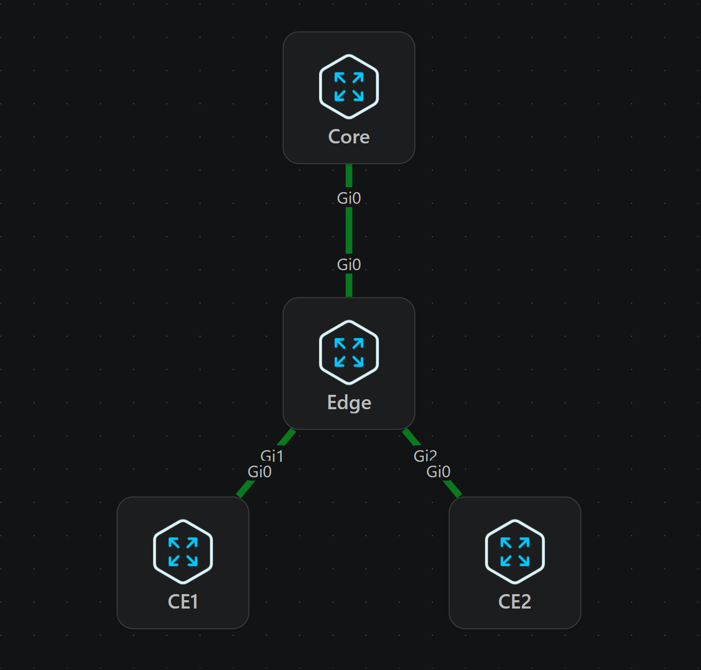

# Zero-Touch VRF & BGP Provisioning

A declarative, idempotent network automation workflow for provisioning customer VRFs, VRF-bound interfaces, and VRF-aware eBGP peering on Cisco IOS/vIOS routers using **Ansible** and **`cisco.ios` resource modules**.

## Problem & Operational Context
Onboarding customer VRFs and eBGP sessions across edge routers manually is repetitive and error-prone, especially when binding interfaces to VRFs, assigning IPv4 addresses, and configuring VRF address-family neighbors. Defining the operation in structured YAML and applying it through declarative resource modules standardizes provisioning and enforces idempotency across repeated runs.

## Lab Topology
Tested in a virtualized **Containerlab** environment on Cisco `vIOS` (`Edge` router in `AS 65001` provisioning isolated VRFs `CUST_A` and `CUST_B` with eBGP neighbors in `AS 65002` and `AS 65003`):



## Repository Structure
```text
ansible-vrf-bgp-resource-modules/
├── README.md
├── ansible.cfg
├── requirements.yml
├── inventory/
│   └── hosts.yml
├── host_vars/
│   └── Edge.yml
├── provision_vrf_bgp.yml          # Main playbook using cisco.ios resource
├── conatinerlab_topology
│   ├── lab.clab.yml               # The conatinerlab topology
│   └── topology_diagram.png       # Lab diagram showing Edge + customer VRFs
└── sample_outputs/
    └── playbook_run_sample.txt    # Output of initial push and idempotent re-run
```

## Quickstart & Usage

### 1. Install Dependencies
```bash
git clone https://github.com/AymaneBENKARY/ansible-vrf-bgp-resource-modules.git
cd ansible-vrf-bgp-resource-modules
ansible-galaxy collection install -r requirements.yml
```

### 2. Configure Inventory & Variables
Update `inventory/hosts.yml` with your lab router reachability details and review customer VRF/BGP definitions in `host_vars/Edge.yml`.

### 3. Dry-Run, Provision, and Verify Idempotency
```bash
# Preview changes safely
ansible-playbook provision_vrf_bgp.yml --check --diff -v

# Apply configuration live
ansible-playbook provision_vrf_bgp.yml

# Re-run to confirm idempotency
ansible-playbook provision_vrf_bgp.yml --check --diff -v
```

## Sample Output
```text
You can see the generated output when running the playbook saved at `sample_outputs/playbook_run_sample.txt`
```

## Tech Stack
* **Automation:** Ansible, `cisco.ios` Resource Modules (`ios_vrf`, `ios_interfaces`, `ios_l3_interfaces`, `ios_bgp_address_family`)
* **Data Modeling:** YAML (`host_vars`, `inventory`)
* **Lab & Routing:** Containerlab, Cisco vIOS, VRFs, eBGP